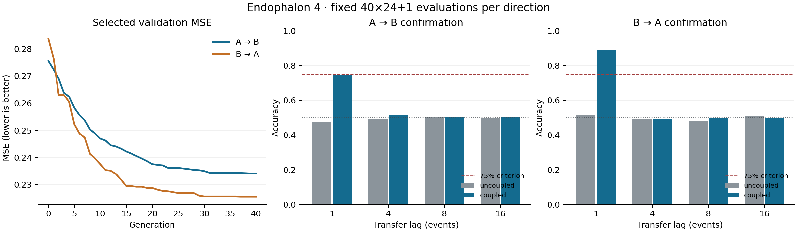

# Endophalon 4 — 최종 연구 보고서

실험일: 2026-11-16 (사용자 기준). 현재 Codex Cloud 컴퓨터에서 Python/NumPy만 사용했다. 외부 GPU·서버·별도 Cloud 작업·GitHub Actions를 사용하지 않았다. 기존 `endophalon3` 브랜치에서 작업했다.

## 결론

고정 탐색 예산 **양방향 각 40세대·961개 후보, 총 1,922개**를 완료했다. 사전 등록한 주요 성공 기준의 동시 충족 여부는 **False**다. 예산 완료와 과학적 성공은 별개다. 결과를 보고 seed·후보 수·세대 수를 추가하지 않았다.

## 모델과 물리적 결합

기존 A/B 각각 144노드, tick당 2 substeps, 16 local readout zones, 입력 간격16·판독지연12를 유지했다. 원래 스프링·질량·감쇠·bath·적분 파라미터와 원래 연산 head는 변경하지 않았다. 두 상태·속도·RNG는 분리되어 있고 두 시계는 매 tick 동시에 진행한다. 각 방향은 별도의 단방향 실험이다.

송신 상태의 Gaussian soft-zone occupancy를 z, home 상태 occupancy를 z₀라 하면:

```text
q = tanh((((z - z₀) / 0.02) · tanh(u[:16])) / 4)
c = world_size ⊙ (1 + tanh(u[16:19])) / 2
w = 0.3 + 1.7 (1 + tanh(u[19])) / 2
g = 0.08 (1 + tanh(u[20])) / 2
F_i = g q exp(-||x_i-c||² / (2w²)) (x_i-c)/(||x_i-c||+1e-9)
```

추가 외력의 노드별 norm은 0.08 이하이다. 이는 무한 시간 안정성의 수학적 증명은 아니다. tick 시작의 실제 송신 상태에서 계산한 힘을 기존 두 substep 동안 유지한다. 학습 변수는 21개이고, 수신 memory head는 자기 16개 관측값에서 네 지연별 출력을 계산하는 Ridge(17×4 가중치 포함)다. 정답·목표 비트·송신 head 출력은 물리적 결합 함수에 들어가지 않는다. 송신이 수신의 영향을 받지 않는 단방향 구조이므로 송신의 실제 궤적을 정확히 캐시해 재사용했다. 캐시/실시간 일치 검증을 통과했다.

## 분할 학습 및 재개 기록

각 세대 atomic 체크포인트를 쓰고 checksum·모델/설정/소스 SHA-256·optimizer/RNG·평가 수를 검증했다. A→B의 실제 사전 성능측정 후보는 generation0으로 보존하여 같은 초기 후보를 중복 평가하지 않았다. 매 5세대 후 프로세스가 종료되었고 다음 프로세스에서 복원했다.

| 구간 | 세대 | A→B 누적 후보 | B→A 누적 후보 | A→B 초 | B→A 초 |
|---|---:|---:|---:|---:|---:|
| 1 | 1–5 | 121 | 121 | 67.18 | 66.19 |
| 2 | 6–10 | 241 | 241 | 61.09 | 64.42 |
| 3 | 11–15 | 361 | 361 | 60.39 | 64.05 |
| 4 | 16–20 | 481 | 481 | 61.80 | 64.03 |
| 5 | 21–25 | 601 | 601 | 62.29 | 66.12 |
| 6 | 26–30 | 721 | 721 | 67.32 | 64.66 |
| 7 | 31–35 | 841 | 841 | 61.60 | 64.13 |
| 8 | 36–40 | 961 | 961 | 62.26 | 63.65 |

소요 시간은 각 방향의 실제 optimizer 실행 시간이며, 검증·문서화·대기 시간을 포함한 전체 세션 벽시계 시간과 다르다.



## 최종 confirmation 기억 전달

| 방향 | 무결합 | 학습 결합 | 차이 | paired stream bootstrap 95% CI | zero | shuffled | 선택 head에 zero | 소프트웨어 레지스터 참고 |
|---|---:|---:|---:|---|---:|---:|---:|---:|
| A_to_B | 49.27% | 56.88% | +7.62%p | [+5.74%p, +9.62%p] | 49.27% | 48.54% | 49.07% | 75.22% |
| B_to_A | 50.20% | 59.64% | +9.45%p | [+8.18%p, +10.74%p] | 50.20% | 50.46% | 49.61% | 75.68% |

물리적 비교군은 동일 입력·물리 RNG·동기화 시계·채점 구간을 사용한다. zero와 무결합은 배열 단위로 일치했다. 무결합/zero/shuffled에는 각각 train-only memory head를 적합했다. 선택 head의 zero ablation도 별도 표시했다. bootstrap은 같은 stream의 결합/무결합 차이를 paired 단위로 삼아 2,000회 재표집했다. stream 내부 event 상관을 독립 표본으로 잘못 세지 않았다. CI는 이 고정 모델·데이터 생성 설정에 조건부이며 학습 seed/모델 간 분산은 포함하지 않는다.

소프트웨어 레지스터 참고는 별도의 명시적 XOR(a,0) 전송 프로그램이다. 저장된 송신 head의 실제 예측을 지연별 레지스터에 보존하고 수신 XOR(register,0)에 입력했다. 정답 레지스터가 아니다. 소프트웨어가 기억을 보존하므로 물리적 기억과 같은 메커니즘으로 해석할 수 없고, 물리적 주 비교군과 입력 프로그램도 달라 직접적인 효과 추정치는 아니다.

| 방향 | split | lag1 | lag4 | lag8 | lag16 | pooled |
|---|---|---:|---:|---:|---:|---:|
| A_to_B | test | 80.08% | 50.78% | 52.54% | 51.56% | 58.74% |
| A_to_B | confirmation | 74.80% | 51.86% | 50.39% | 50.49% | 56.88% |
| B_to_A | test | 88.48% | 52.15% | 52.15% | 50.39% | 60.79% |
| B_to_A | confirmation | 89.16% | 49.51% | 49.90% | 50.00% | 59.64% |

사전에 각 지연을 합친 방향별 pooled 정확도로 주요 75% gate를 고정했고, 지연별 결과도 모두 공개했다. 최종 confirmation은 양방향 모델 선택을 끝낸 뒤 단일 평가 호출에서만 사용했다. 그 호출 안의 같은 입력 물리 재실행은 결정성 검사에만 사용했고 선택에 반영하지 않았다.

## 기존 연산 보존

원래 저장된 A/B head를 재학습하지 않고 동일한 random instruction 프로그램에서 비교했다. 모든 채점은 event16 이후다. sender는 결합의 영향을 받지 않는다.

| 방향 | 모델 역할 | 모델 | 무결합 | 결합 | 변화 |
|---|---|---|---:|---:|---:|
| A_to_B | sender | A | 89.55% | 89.55% | +0.00%p |
| A_to_B | receiver | B | 76.37% | 59.67% | -16.70%p |
| A_to_B | receiver xor (n=128) | B | 79.69% | 54.69% | -25.00%p |
| A_to_B | receiver recall1 (n=108) | B | 70.37% | 47.22% | -23.15%p |
| A_to_B | receiver recall2 (n=129) | B | 67.44% | 48.06% | -19.38%p |
| A_to_B | receiver xor_mem (n=115) | B | 55.65% | 54.78% | -0.87%p |
| A_to_B | receiver and (n=129) | B | 96.12% | 86.05% | -10.08%p |
| A_to_B | receiver or (n=145) | B | 95.17% | 58.62% | -36.55%p |
| A_to_B | receiver parity3w (n=121) | B | 51.24% | 50.41% | -0.83%p |
| A_to_B | receiver and_mem (n=149) | B | 86.58% | 72.48% | -14.09%p |
| B_to_A | sender | B | 77.44% | 77.44% | +0.00%p |
| B_to_A | receiver | A | 87.21% | 61.72% | -25.49%p |
| B_to_A | receiver xor (n=235) | A | 97.45% | 70.21% | -27.23%p |
| B_to_A | receiver recall1 (n=249) | A | 94.38% | 71.49% | -22.89%p |
| B_to_A | receiver recall2 (n=267) | A | 71.16% | 53.18% | -17.98%p |
| B_to_A | receiver xor_mem (n=273) | A | 87.55% | 53.85% | -33.70%p |

| 방향 | 75% | +10%p | 전체 연산 하락 ≤3%p | 수신 연산 하락 | 모든 지연 ≥75% | finite | 재현 |
|---|---|---|---|---:|---|---|---|
| A_to_B | False | False | False | +16.70%p | False | True | True |
| B_to_A | False | False | False | +25.49%p | False | True | True |

## 재현성·감사·실행 환경

- 총 1,922개 후보의 세대/후보 개수, 누락/중복 세대, optimizer/RNG 전이 80개를 검사했다. 기록된 실제 후보 결과를 재사용해 전이를 복원했으며 추가 물리 후보 탐색은 하지 않았다.
- 저장 모델의 네 출력 head로 관측 증거를 다시 계산한 결과가 동일했다. fresh receiver 물리 재실행도 bitwise 일치했다.
- 기존 테스트를 포함한 pytest 94개, 모델 smoke 8종, 백업 보존 검사 통과. 상세 출력은 verification.json에 보존한다.
- 이전 모델/실험 증거 299개 파일의 SHA-256을 보존했다. 전체 보호 목록은 preservation_baseline.json에 있다.
- 숫자 상태는 매 tick finite를 검사했고, 방향별 추가 1,024 events / 16,416 ticks 장기 실행을 검사했다. 무한 시간/모든 입력 안정성을 보장하지 않는다.

### A_to_B

```json
{
  "environment": {
    "python": "3.12.14 (main, Aug 25 2026, 14:00:49) [Clang 22.1.3 ]",
    "numpy": "2.3.5",
    "platform": "Linux-6.18.57-x86_64-with-glibc2.41",
    "cpu_count": 3,
    "affinity": 3,
    "cpu_max": "200000 100000",
    "memory_max": "8589934592",
    "workers": 2,
    "blas_threads": "1"
  },
  "elapsed_optimizer_seconds": 505.0708475320007,
  "failed_candidates": 0,
  "long_horizon": {
    "finite": true,
    "events": 1024,
    "ticks_each": 16416,
    "max_abs_receiver_position": 7.078591712784173,
    "max_abs_receiver_velocity": 0.5178392585523423
  }
}
```

### B_to_A

```json
{
  "environment": {
    "python": "3.12.14 (main, Aug 25 2026, 14:00:49) [Clang 22.1.3 ]",
    "numpy": "2.3.5",
    "platform": "Linux-6.18.57-x86_64-with-glibc2.41",
    "cpu_count": 3,
    "affinity": 3,
    "cpu_max": "200000 100000",
    "memory_max": "8589934592",
    "workers": 2,
    "blas_threads": "1"
  },
  "elapsed_optimizer_seconds": 516.2295770850003,
  "failed_candidates": 0,
  "long_horizon": {
    "finite": true,
    "events": 1024,
    "ticks_each": 16416,
    "max_abs_receiver_position": 5.945439959148786,
    "max_abs_receiver_velocity": 0.31566753642794687
  }
}
```

## 데이터·산출물·제약

각 방향 train4/validation4/test16/confirmation32 streams, stream당48 events, lag별32 scored events다. 네 split은 고정 seed·ID가 서로 다르고 v3 confirmation ID와도 겹치지 않는다. source/receiver 입력은 별도 seed·ID로 생성했다. 정확한 값은 configs/endophalon4/experiment.json에 있다. 128개 train/validation event는 작은 데이터이며 961개 후보의 검증 선택은 과적합할 수 있다. test/confirmation 결과로 재선택하지 않았다.

- `models/endophalon4/{A_to_B,B_to_A}/model.json`: 최종 21개 결합 계수·train-only memory head·모델/설정/소스 SHA-256.
- 같은 방향 디렉터리의 `checkpoints.tar.gz`: generation0–40 전체 optimizer state, RNG, best 결과, 세대 이력과 구간 기록. 원본 체크포인트와 압축본 해시는 checkpoint_manifest.json에 있다.
- `docs/endophalon4/*_history.json`: 세대별 후보 결과, 실패 기록, 구간 시간, 환경.
- `docs/endophalon4/evaluation.json`, `*_observations.npz`, `audit.json`, `verification.json`: 측정·증거·검사 결과.
- `docs/endophalon4/reproduce.md`: 설치, 압축 해제, status/verify/resume/audit 명령.

압축하지 않은 체크포인트도 현재 Cloud 작업 공간에 남겨 두었다. GitHub에는 압축본만 올려 반복 JSON의 중복을 줄였다. 다른 환경의 optimizer 재개는 엄격한 환경/해시 검사 때문에 거절될 수 있다. 저장 증거 분석과 이번 호스트의 bitwise 재현 성공을 구분해야 한다. 마지막 정상 파일이 손상되면 완료 세대를 조용히 반복하지 않고 중단한다.

## 실패 원인과 해석의 한계

성공 gate를 놓친 항목은 위 표 그대로 실패다. 학습 목적 함수는 validation MSE이며 정확도 gate나 기존 연산 보존을 직접 최적화하지 않았다. 21변수의 단일 스칼라 결합/단일 공간 주입은 통신 대역폭과 공간 선택에 제약이 있다. 원래 16-zone readout은 새 기억 전달용으로 최적화되지 않았고 긴 지연은 최대256 ticks에 해당한다. 이 설명들은 구조적 제약 또는 가능한 원인이지 인과적으로 검증된 원인은 아니다.

단일 초기 A/B 쌍, 단일 search seed/방향, 작은 훈련·검증 집합의 실험이다. 모델/seed 전반의 일반화나 물리 기억 전달의 불가능성을 입증하지 않는다. Endophalon 3의 비활성 모델 pause 방식과 여기의 동기화 방식 차이는 주 비교군에서도 통제했다. 소프트웨어 레지스터와 물리적 기억을 동일시하지 않았다.

Endophalon 5를 설계하기 전 이 고정 예산 결과를 기준선으로 사용해야 한다. 이번 작업에서는 다음 버전 설계·새 seed 탐색·추가 세대·새로운 실험을 시작하지 않았다.
